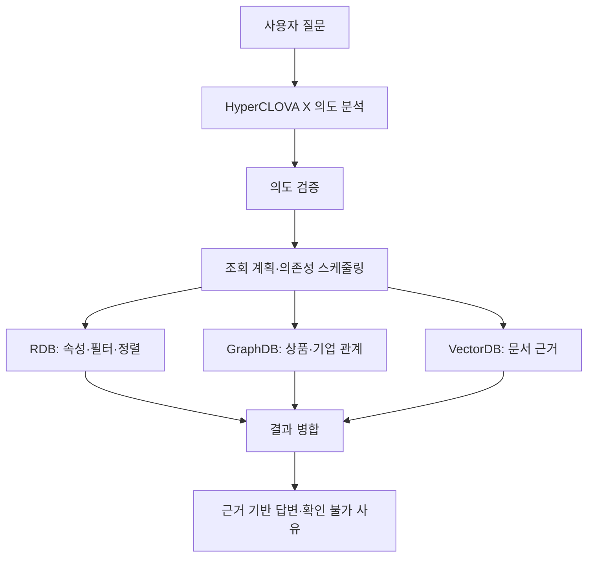

# 금융상품 Agent — Financial Product Analyst

제10회 미래에셋증권 AI Festival 금융상품 Agent 과제. 국내채권·국내ETF·해외ETF·공모펀드에 대한 자연어 질문을 분석하고, **RDB · GraphDB · VectorDB에서 조회한 근거를 바탕으로 답변**합니다.

## 프로젝트 목적과 주요 기능

정형 데이터의 상품 속성과 수치만으로는 “삼성전자를 편입한 ETF” 같은 관계 질의나 투자설명서의 서술형 정보까지 답하기 어렵습니다. 금융상품 온톨로지로 개념·관계를 정의하고, 질문에 필요한 저장소를 선택해 조회 결과와 문서 근거를 결합합니다.

| 구성요소 | 역할 |
|---|---|
| 데이터 정제·온톨로지 | 상품 개념, 속성, 관계, 출처와 허용값 정의 |
| 금융상품 Knowledge Base | RDB의 수치·조건 조회, Graph의 관계 탐색, Vector의 문서 검색 |
| Intent Analysis·Retrieval | 의도 분석·검증, 실행 계획과 검색 단계 간 의존성 처리 |
| Answer Generator | 검색 결과를 근거로 답변하고, 확인하지 못한 항목과 사유 표시 |

### 데이터·답변 원칙

- **데이터 기준일은 2026-08-24**이며 외부 데이터도 `as_of ≤ 2026-08-24`만 사용합니다. 답변의 근거에는 배포일과 별개로 테이블·행의 실질 기준일을 표시합니다.
- 주최측 데이터와 외부 데이터가 상충하면 주최측 값을 우선하고 상충 사실을 근거에 기록합니다.
- **질의 의도 분석과 답변 생성에는 NCP HyperCLOVA X만 사용**합니다. 그 외 작업의 모델 제약은 [프로젝트 규칙](AGENTS.md)을 따릅니다.
- 상품명은 완전일치를 우선합니다. 존재하지 않는 등급, 미래 실현값, 상품 부재, 도메인 위반 등은 사유를 구분해 “확인할 수 없음”으로 답해야 합니다.
- **응답 15초 이내가 평가 목표**입니다. 현재 타임아웃 설정만으로 15초를 보장하지 않으며, 외부 서비스까지 포함한 실측이 필요합니다.

## 파이프라인과 현재 구현



LangGraph가 `depends_on`에 따라 실행 가능한 검색 단계를 묶어 실행합니다. 독립적인 Graph·RDB 조회는 동시에 실행할 수 있고, Graph에서 찾은 상품을 RDB로 조회하는 경우에는 순차 실행합니다. 실제 노드와 분기는 [graph.py](src/agent/graph.py)에 있습니다.

현재 브랜치의 RDB 경로는 [도메인 카탈로그](src/tools/rdb_schema.py)로 속성·조건을 해소하고, [SQL 빌더](src/agent/sql_builder.py)가 처리 가능한 질의를 결정론적으로 컴파일합니다. 처리할 수 없는 질의는 LLM SQL 생성·수리 경로를 사용합니다. Graph는 pyoxigraph/HTTP 어댑터, Vector는 PostgreSQL·pgvector 어댑터로 연결합니다.

## 환경 설정

Python 가상환경을 만든 후 [requirements.txt](requirements.txt)의 의존성을 설치합니다. Python 최소 지원 버전과 OS별 호환성은 별도 검증이 필요합니다.

```bash
python3 -m venv .venv
source .venv/bin/activate
python -m pip install -r requirements.txt
```

Windows PowerShell에서는 가상환경 활성화에 `.venv\Scripts\Activate.ps1`을 사용합니다.

`.env`가 없다면 [.env.example](.env.example)을 복사하고 연결 정보를 채웁니다. 기존 `.env`가 있으면 필요한 항목만 보완합니다. `.env`는 커밋하지 않습니다.

| 변수 | 용도 |
|---|---|
| `CLOVA_API_KEY` | CLOVA Studio API 키. `CLOVASTUDIO_API_KEY`도 인식 |
| `CLOVA_EMBEDDING_MODEL` | 기본 `bge-m3`. VectorDB 적재 모델과 일치해야 함 |
| `RDB_API_BASE_URL` | RDB SQL API 주소. `POST /db/sql` 사용 |
| `RDB_API_TIMEOUT` | RDB 요청 타임아웃. 기본 30초 |
| `DATABASE_URL` 또는 `PGHOST`·`PGPORT`·`PGDATABASE`·`PGUSER`·`PGPASSWORD` | VectorDB PostgreSQL 연결 정보 |
| `VECTOR_SCHEMA` / `VECTOR_DB_TIMEOUT` | 기본 스키마 `vec` / 기본 타임아웃 3초 |
| `OXIGRAPH_REMOTE_STORE_PATH` | 마운트한 읽기 전용 Graph 저장소 |
| `OXIGRAPH_LOCAL_STORE_PATH` | 로컬 Graph 저장소. 미설정 시 `artifacts/oxigraph` |
| `OXIGRAPH_FALLBACK_ENDPOINT` | 파일 저장소를 사용할 수 없을 때 조회할 SPARQL URL. 서버가 제공하는 경로까지 포함 |
| `OXIGRAPH_TIMEOUT` | Graph 요청 타임아웃. 기본 60초 |

Graph 연결은 원격 마운트 → 로컬 저장소 → HTTP endpoint 순서로 시도합니다. DB와 API 키는 의존성 설치와 별도로 준비해야 합니다. 세부 설정은 `.env.example`과 각 어댑터 구현을 확인하세요.

## 실행

저장소 루트에서 실행하며, `src/`를 import 경로에 포함합니다.

```bash
PYTHONPATH=src python -c "from agent.graph import app; result = app.invoke({'question': 'VOO의 정식 상품명과 총보수를 알려줘', 'question_id': 'Q-001'}); print(result['answer'])"
```

Windows PowerShell:

```powershell
$env:PYTHONPATH='src'
$env:PYTHONUTF8='1'
python -c "from agent.graph import app; print(app.invoke({'question': 'VOO의 정식 상품명과 총보수를 알려줘', 'question_id': 'Q-001'})['answer'])"
```

`app.invoke()`는 파이프라인 상태를 반환합니다. 답변 관련 필드는 `question_id`, `question`, `retrieved_context`, `think_trace`, `answer`입니다. 입력의 `max_sql_retries`로 SQL 실패 재시도 횟수를 조정할 수 있으며 기본값은 3입니다.

현재 브랜치에는 평가용 HTTP 서버 `serve_answer`가 없습니다. 위 Python 호출이 실제 진입점이며, 과거 문서의 `agent.agent_core.ask()`도 현재 존재하지 않습니다.

### 질의 예시

- “VOO의 정식 상품명과 총보수를 알려줘.”
- “AA- 이상이면서 잔존기간 3년 이하인 회사채를 매수수익률 순으로 보여줘.”
- “우리반도체BIG2플러스의 C-P와 C-Pe 클래스가 동일한 모펀드의 클래스인지 확인하고, 클래스별 종목번호·판매 여부·순자산·수익률을 비교해줘.”
- “최근 6개월 동안 우주항공 테마와 연결된 이력이 있는 ETF를 정리하고, 현재 편입 관계와 뉴스 언급을 구분해 근거를 제시해줘.”

예시는 조회 요청이며 정답이나 데이터 확보를 보장하지 않습니다. 확보된 데이터·문서로 확인되지 않는 항목은 그 사유를 표시해야 합니다.

## 온톨로지와 데이터 취급

[ontology/](ontology/)의 `common.ttl`, `bond_kr.ttl`, `etf_kr.ttl`, `etf_gl.ttl`, `fund_pub.ttl`이 상품 도메인을 정의합니다. 네임스페이스는 `fp: <http://mafest.ai/product#>`입니다.

- 편입 관계는 `fp:Holding` 중간 개체로 비중·기준일·근거를 함께 표현합니다.
- `domain/range`와 신용등급 순위를 선언해 허용되는 질의와 비교 범위를 정의합니다.
- DatatypeProperty의 `fp:sourceTable`·`fp:sourceColumn`으로 원천을 추적합니다.

`data/csv/`는 동결 영역이며 재생성 가능한 산출물은 `artifacts/`에 둡니다. 집계·필터 작성 전 [AGENTS.md의 데이터 함정](AGENTS.md)을 확인해야 합니다. 특히 국내ETF/ETN 구분, 펀드·채권 키, 더미 괴리율, 총보수 결측, 편입종목 미확보를 주의합니다.

## 검증

SQL 컴파일 계약은 외부 LLM·DB 호출 없이 확인할 수 있습니다.

```bash
python script/agent_test/test_sql_builder.py
```

환경 설정 후 관련 회귀 테스트를 실행합니다. 일부 테스트는 import 시점에 CLOVA 객체를 생성하므로 API 키와 설치된 의존성이 필요합니다.

```bash
python script/agent_test/test_domain_as_of.py
python script/agent_test/test_vector_search_node.py
python script/graph_db/test_client_failover.py
python script/graph_db/test_entity_index.py
python script/vector_db/test_client_sql.py
```

골든셋 E2E 실행은 실제 LLM·DB를 호출합니다. 출력 폴더를 준비하고 원시 trace 저장 위치를 지정합니다.

```bash
mkdir -p artifacts/eval/readme-run
PYTHONPATH=src PYTHONIOENCODING=utf-8 python test/pipline-test/latency/run_latency.py --rounds 2 --out artifacts/eval/readme-run/traces.jsonl
```

채점기는 `test/pipline-test/latency/analyze.py`입니다. 현재 `--output-dir` 옵션이 없고 결과를 해당 스크립트 폴더의 기존 파일에 쓰므로, 실행 전 산출물 보존 여부를 확인해야 합니다. 기준은 [평가 루브릭](test/pipline-test/golden_set_data_gap_evaluation_rubric.md)과 [골든셋](goldset/golden_answers_20260824.csv)입니다.

## 저장소 구조와 문서

```text
src/
  agent/           의도 분석·라우팅·검색·답변 생성
  tools/           도메인 카탈로그·검색 도구
  infrastructure/  GraphDB·VectorDB 연결
  kb/              데이터 적재·지식베이스 빌더
ontology/          도메인 온톨로지
script/            검증·수집·보조 스크립트
data/              원천·보강 데이터
artifacts/         재생성 가능한 산출물
metadata/          메타데이터
goldset/           평가용 골든셋
test/              실험·회귀·지연 측정
docs/              설계·데이터·비교 문서
```

| 문서 | 내용 |
|---|---|
| [아키텍처](src/ARCHITECTURE.md) | 구성요소와 설계 설명 |
| [데이터 레이어](docs/docs_data_layer/데이터%20레이어.md) | 계층·파일·출처 규칙 |
| [컬럼 가이드](docs/docs_data_layer/컬럼%20가이드.md) | 데이터 컬럼 정의 |
| [DB API](docs/docs_DB_connection/DATA_API_V1.md) | DB 조회 API 규격 |
| [DB 스키마 인계](docs/docs_DB_connection/AGENT_DB_SCHEMA_HANDOFF.md) | Agent 연결용 스키마 |
| [브랜치 비교·README 통합 기록](docs/branch_comparison_0906.md) | 현재 브랜치와 final의 차이, README 선택 근거 |

과거 설계·실험 문서는 당시 상태를 설명할 수 있습니다. 실행 경로는 현재 소스와 환경 설정을 기준으로 확인하세요.
