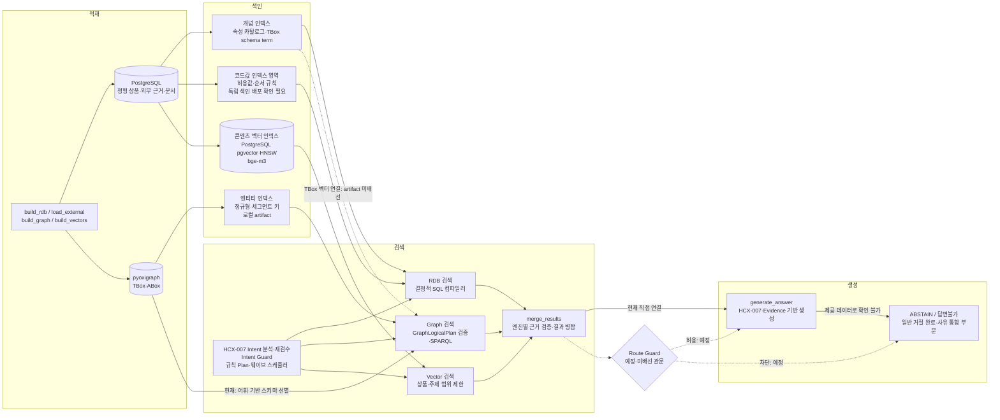

## 3. 시스템 구성도

시스템은 적재·색인·검색·생성의 네 계층으로 구성된다. 정형 수치는 관계형 데이터베이스(RDB), 금융상품 관계는 지식그래프(Knowledge Graph), 서술 근거는 벡터 검색(Vector Search)이 담당한다. 아래 화살표는 컴포넌트 간 제공·참조 관계이며, 데이터 생성 순서와 실행 절차는 4절에서 설명한다.

적재 계층은 주최측 정본과 외부 근거를 보관하는 PostgreSQL, 온톨로지와 상품 관계를 보관하는 pyoxigraph로 구성된다. 색인은 개념·코드값·엔티티·콘텐츠를 분리한다. 네 종류가 모두 벡터 인덱스인 것은 아니다. 개념은 속성 카탈로그와 TBox 색인, 코드값은 허용값·순서 규칙, 엔티티는 정규형·세그먼트 키 인덱스, 콘텐츠는 pgvector 기반 문서 색인에 대응한다. 독립 코드값 검색 인덱스의 배포 상태는 확인이 필요하다.

검색 계층에는 HCX-007 Intent 분석·재검수, 결정적 Intent Guard, 규칙 기반 Plan과 의존관계 스케줄러, SQL 컴파일러, GraphLogicalPlan 검증기, 상품 범위 제한 문서 검색기가 배선돼 있다. Graph의 TBox 벡터 연결은 artifact 부재로 미배선이며, 현재 스키마 선별은 어휘 기반 대체 검색을 사용한다.

생성 계층은 병합된 근거(Evidence)를 사용하는 HCX-007 답변 생성기로 구성된다. 현재 검색 결과 병합과 생성기는 직접 연결돼 있다. 도식의 Route Guard는 검색과 생성 사이에 배치할 예정 관문이며, Intent Guard와 별개다. 일반 답변불가는 구현됐지만, 관문을 통한 통합 답변 거절(ABSTAIN)과 사유 타입 표준화는 미완료다. 모든 RDB 주장에 대한 근거 계약도 부분 구현이다.

범례: 실선 `-->`은 현재 연결·참조, 점선 `-.->`은 예정 또는 미배선 연결이다. Route Guard는 현재 필수 경유점이 아니다.

| 단계       | 입력                 | 처리                      | 출력                      | 사용 기술                                             | 구현 상태(완료·부분·예정)                                         |
| -------- | ------------------ | ----------------------- | ----------------------- | ------------------------------------------------- | ------------------------------------------------------- |
| 적재       | 주최측 정본·외부 근거·문서    | 정본·기준일·출처 관리            | 정형 테이블·TBox·ABox·문서 저장소 | PostgreSQL, pyoxigraph, 적재 빌더                     | 부분: 기본 저장소 완료, 원격 보강 테이블·제출 환경 적재 확인 필요                 |
| 색인       | 스키마·허용값·엔티티·문서     | 개념·코드값·엔티티·콘텐츠 분리       | 카탈로그·규칙·키 인덱스·벡터 인덱스    | 로컬 artifact, pgvector, HNSW, bge-m3               | 부분: 엔티티·콘텐츠 검색 구현, Graph TBox 벡터 연결 미배선·독립 코드값 색인 확인 필요 |
| 검색       | 구조화 Intent·카탈로그·색인 | 규칙 계획·수치 조건·관계 검증·문서 검색 | 검색 결과·근거·검색 상태          | HCX-007, Python, PostgreSQL, pyoxigraph, pgvector | 부분: 기본 검색 완료, SQL 폴백·상품명 부분일치·RDB 근거 통합 과제 잔존           |
| 검색–생성 관문 | 병합 결과·검증 상태        | 통합 허용·거절 판정             | 생성 허용 또는 ABSTAIN        | Route Guard(예정 구성)                                | 예정: 전역 관문 미배선                                           |
| 생성       | 병합된 Evidence       | 근거 기반 답변·일반 답변불가 처리     | 답변 또는 답변불가 응답           | HyperCLOVA X HCX-007                              | 부분: 생성기 배선 완료, 필드 누락·빈 응답·거절 사유 통합 개선 필요                |

