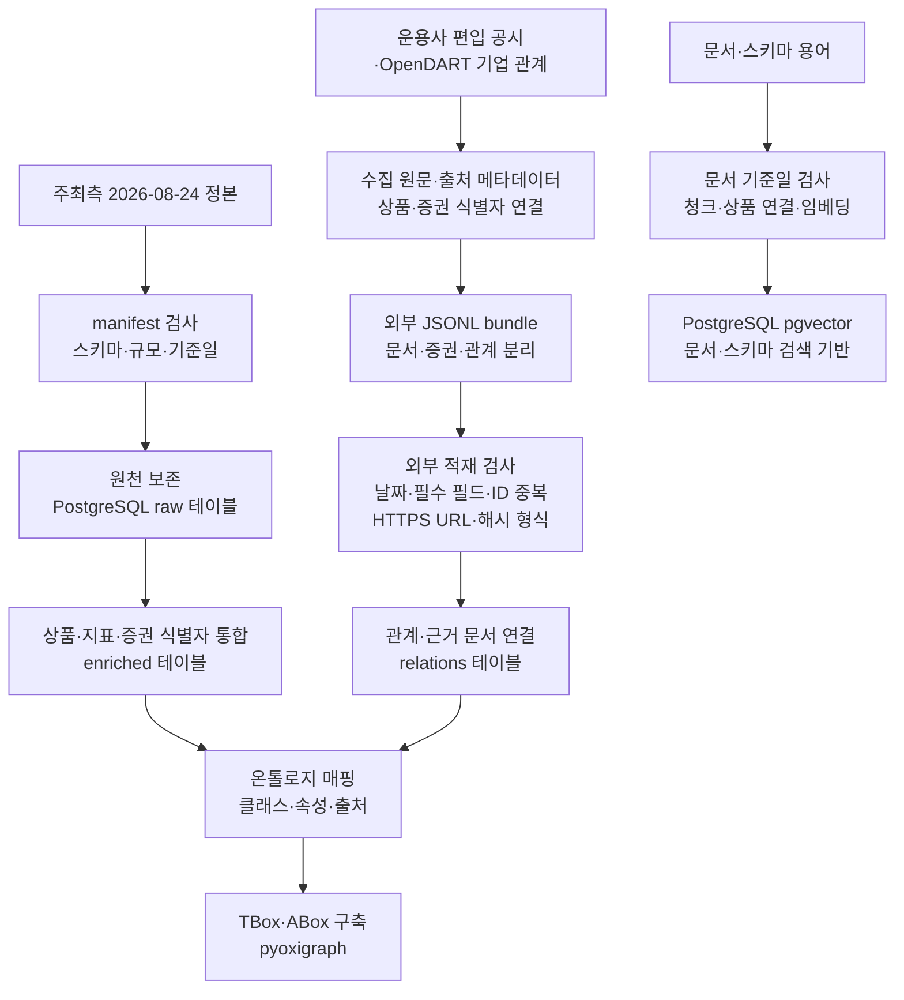

## 4. 데이터·온톨로지 기반과 거버넌스

**주최측 정본을 보존하고 상품·지표·관계·근거 문서를 분리 구축해, 답변의 수치와 관계를 원천까지 추적할 수 있게 했다.** 데이터 사용 상한(cutoff), 실제 관측 기준일, 출처 계보(provenance)는 서로 다른 정보로 관리한다. **구현 완료:** 정본 검사·외부 데이터 날짜 검사·온톨로지 출처 매핑. **부분 구현:** 전체 RDB 답변에 대한 표준 근거 계약 통합과 제출 환경 검증.

### 4.1 데이터 범위와 정본

**운영 정본은 2026-08-24 배포본의 원천 53,375행이며, 통합 상품은 51,990개다.** 원천 행 수는 상품 단위 통합 결과와 구분한다. `data/csv/`는 값 수정·컬럼 추가·파생물 저장을 금지하는 동결 영역으로 유지하고, 재생성 가능한 산출물은 `artifacts/`에 둔다.

| 도메인 | 원천 코드 | 원천 행 수 | 컬럼 수 | 적재 대상 |
|---|---|---:|---:|---|
| 국내채권 | PRBD01N001 | 21,882 | 58 | `raw.bond_kr_master` |
| 국내 ETF·ETN | PREF01N001 | 1,780 | 98 | `raw.etf_kr_master` |
| 해외 ETF·ETN | PREF02N001 | 6,037 | 49 | `raw.etf_gl_master` |
| 펀드(공모·사모) | PRFD01N001 | 23,676 | 75 | `raw.fund_pub_master` |
| 합계 | 4개 파일 | 53,375 | 280 | 원천별 분리 보관 |

출처: `src/kb/manifest.py`의 `SOURCES` 선언과 원격 스키마 기록. 배포일은 2026-08-24, 원격 테이블 규모 확인일은 2026-09-05다. 컬럼 수 합계는 파일별 컬럼 수의 합이며, 금융 수치의 관측 기준일을 뜻하지 않는다.

**구현 완료 — 구축 방식:** 원천 스키마·규모·날짜 검사 후 원천 테이블을 보존하고, 상품 식별자와 지표를 분리한 통합 테이블을 구성했다. 외부 공시에서 확보한 편입·기업 관계에는 근거 문서 식별자를 연결하고, 온톨로지 정의와 상품·관계 데이터를 그래프로 표현했다.

| 구축 결과 | 규모 | 저장소·집계 대상 |
|---|---:|---|
| 통합 상품 | 51,990개 | `enriched.product_master` |
| 상품 지표 | 113,146행 | `enriched.product_metric` |
| 표준 증권 | 71,953개 | `enriched.security_master` |
| 상품 분류 | 61,744행 | `relations.product_classification` |
| ETF 편입관계 | 46,951행 | `relations.product_holding` |
| 기업 관계 | 8,866행 | `relations.company_subsidiary` |
| 외부 근거 문서 | 2,345건 | `relations.source_document` |

출처: `docs/docs_DB/2026-09-05_remote_vs_local_db_schema.md`, 2026-09-05 원격 규모 기록. 관계·지표의 실제 기준일은 각 행의 `as_of`, 근거 문서의 발행일은 `published_at`으로 별도 관리한다.

- **외부 관계 근거:** 국내 ETF holdings 공시 711건과 OpenDART 기업 관계 문서 1,634건으로 총 2,345건을 확보했다. 외부 파생 관계는 편입관계와 기업 관계를 합한 55,817행이다.
- **Vector 적재 기록:** 2026-09-05 기준 `vec.schema_terms_all` 189건, `vec.source_document` 974건, `vec.document_chunk` 9,055건, `vec.chunk_embedding` 5,664건, `vec.document_product` 1,019건, `vec.product_coverage` 15,951건이다. 관계 근거 문서 2,345건과 Vector 문서 974건은 서로 다른 집계 대상이다.
- **부분 구현:** 문서 임베딩은 bge-m3 1024차원과 pgvector를 사용한다. 청크 수와 임베딩 수가 다르므로 전체 청크의 임베딩 완료를 주장하지 않는다. `product_coverage` 행 수도 문서 확보 상품 수로 해석하지 않는다.

[확인 필요] 제출 환경의 최종 적재 규모와 문서 확보 상태별 분포. 위 수치는 기록된 스냅샷이며 이번 문서 작성에서 원격 DB를 재측정한 결과는 아니다.

#### 4.1.1 외부데이터 수집 대상과 정보 보강

**외부데이터는 주최측 데이터에 없는 편입관계·기업 연결·위험요인·이력을 보강하는 데 우선 투입했다.** [외부데이터 구축 재검증_0830](../docs/docs_data_collection/외부데이터/외부데이터%20구축%20재검증_0830.md)은 2026-08-30에 작성한 수집 계획 재검토 자료다. 문서 작성일은 사용 정보의 cutoff가 아니며, 아래 계획을 수집 완료 실적으로 해석하지 않는다.

| 보강 대상·원천의 공백 | 수집 경로와 확보 방식 | 정규화·적재 및 활용 | 구현 상태·남은 범위 |
|---|---|---|---|
| 국내 ETF 편입종목: 상품 마스터만으로 기업 보유 여부 확인 불가 | 기존 KODEX·TIGER·RISE·ACE 수집 경로의 편입 공시. 재검증안은 08-24 마스터에 맞춘 재수집과 PLUS·SOL 어댑터 확장을 제안 | 상품의 `pd_isin_cd`·`pd_ticker` 등 식별자를 대조해 `product_id`에 연결하고, 편입증권·비중·`as_of`·근거 문서를 `relations.product_holding`에 저장 | **부분 구현:** 기존 편입관계 적재 기록은 있음. 재수집 완료일·PLUS·SOL 확보 범위는 확인 필요 |
| 기업 지배구조·해외종목 이름: 자회사와 편입증권의 연결 부족 | OpenDART 기업 관계와 KIND·DART 기업 식별 자료. 해외 별칭은 실제 holdings에 나타난 이름·티커를 우선 대상으로 확장 | 기업·증권을 `security_id`로 연결하고 `security_identifiers`에 식별자 유형·값을 분리. 부모·자회사 관계는 `company_subsidiary`에 저장 | **부분 구현:** 기업 관계·증권 식별자 적재는 구현. 해외 별칭 확장·마스터 리프레시 범위는 확인 필요 |
| 위험요인·투자전략: 정형 컬럼으로 설명할 수 없는 내용 | OpenDART `document.xml`을 접수번호(`rcept_no`)로 조회하는 경로와 운용사 투자설명서 PDF. 펀드 편입·운용경과는 금투협 자산운용보고서 수집 계획 | 원문과 상품 연결을 보존하고, 투자위험 등 주제별 문서 청크를 Vector 검색 대상으로 구성 | **부분 구현:** 문서·청크·임베딩 적재 기록은 있음. 경로별 성공 실적과 금투협 수집 완료 여부는 확인 필요 |
| 정책·테마 이력: 단일 테마 스냅샷으로 과거 사건 확인 불가 | 금융위 정책자료·운용사 공지, KIND 신규상장·명칭변경 공시, 지수 리밸런싱 공지를 수집 대상으로 선정 | 정책 설명은 문서 근거로, 사건은 ETF·사건유형·사건일·출처·`as_of`를 갖는 `etf_theme_event` 형태로 구축하는 계획 | **확인 필요:** 수집·이력 테이블 적재 완료 근거 미확인. 현재 테마 분류를 이력으로 대체하지 않음 |
| 해외 ETF 편입·합성형 노출: 국내 holdings만으로 범위 충족 불가 | SEC `company_tickers_mbfd.json`의 티커·시리즈 매핑을 이용한 N-PORT 수집 설계. 합성형은 지수사 구성종목 자료를 별도 확보하는 계획 | 공시 발행일과 보유 기준일을 분리하고, 지수 노출과 실제 보유를 구별해 표현 | **확인 필요:** 참조 문서상 수집 설계 단계. 해외 편입·합성형 지수 자료의 현재 적재 완료는 미확인 |

**수집 우선순위:** 재검증안은 순자산 상위 ETF, 우주항공·중국반도체·이차전지 테마, 국민성장펀드, 에코프로 자회사 편입 상위 ETF의 근거 문서를 우선 대상으로 정했다. 순자산 정렬 등 주최측 컬럼으로 가능한 기능은 원천을 사용하고, 외부 수집은 답변에 부족한 관계와 서술 근거에 집중한다. 채권 판매·호가 보완과 국내 ETF 기초지수의 전면 수집은 원천·공지로 해소되는 범위를 확인해 우선순위를 낮췄다.

#### 4.1.2 원문에서 관계·문서 저장소까지의 적재 계약

**구현된 적재기는 외부 원문을 직접 답변에 붙이는 대신, 문서·증권·관계를 분리한 묶음을 검사한 뒤 저장한다.** 수집 단계의 공통 보존 규약은 재검증안, 아래 필드·검사는 `src/kb/load_external.py`를 근거로 한다.

1. **수집·보존 규약:** 원본과 `{파일명}.meta.json`에 URL·취득일·`as_of`를 보관한다. 취득일은 작업 이력, `published_at`은 문서 발행일, `as_of`는 보유내역·관측값의 기준일이다. 과거 기준으로 조회해도 현재값을 반환하는 가격·등락 컬럼은 적재 대상에서 제외한다. 이 사이드카 규약의 전 수집물 적용 여부는 확인 필요다.
2. **식별자·레코드 분리:** `artifacts/external_v2/`의 JSONL 묶음은 `source_documents`, `securities`, `security_identifiers`, `product_holdings`, `product_classifications`, `company_subsidiaries`, `product_documents`로 나뉜다. 상품명만으로 연결하지 않고 상품·증권 식별자를 사용한다. 해외 이름·티커의 별칭 확장은 원문 식별자를 보존한 상태에서 확인해야 한다.
3. **적재 전 검사:** `published_at`·`as_of`·관측기간 필드가 있으면 cutoff 이하인지 확인하고, 레코드별 필수 필드와 중복 식별자를 검사한다. URL은 HTTPS 형식, `source_hash`는 SHA-256 형식을 검사한다. 이 검사는 URL의 공식 출처 여부나 실제 원문과 해시의 일치까지 보증하는 것은 아니다.
4. **저장·재적재:** `load_external.py`는 검사를 통과한 묶음을 `*_next` 스키마에 적재하며, 식별자 충돌 시 해당 레코드를 갱신한다. 공개된 `relations.*` 규모 기록과 작업용 적재 경로를 구분한다. 최종 운영 반영 여부는 배포 스냅샷으로 확인한다.
5. **근거 연결:** 문서는 `document_id`, 발행자·발행일·URL·원문 해시를 갖는다. 편입관계는 `product_id`, `security_id`, 비중·단위, `as_of`, `source_document_id`를 갖고, 기업 관계는 부모·자회사 식별자와 근거 문서를 갖는다. 이 연결을 통해 Graph 관계와 문서 설명을 동일 상품의 원문까지 추적한다.

예를 들어 **자회사 관계(OpenDART) + ETF 편입관계(운용사 공시) + 순자산(주최측 원천) + 위험요인(투자설명서)**을 연결하면, “자회사를 편입한 ETF 중 순자산이 큰 상품의 위험요인”에 필요한 서로 다른 근거를 구성할 수 있다. 이는 보강 데이터의 역할을 설명한 예이며 해당 질의의 최종 정답률 검증을 의미하지 않는다.

**이력 보존 계획:** 07-10 holdings는 cutoff 안의 유효한 과거 자료로 보존하고, 재수집본은 실제 기준일을 확인한 별도 스냅샷으로 관리한다. 두 시점에서 확인한 차이는 해당 관측 시점 사이의 변화 근거이며, 연속적인 전체 변경 이력을 확보한 것으로 표현하지 않는다. N-PORT도 보유 기준일이 문서 발행일보다 과거일 수 있으므로 최신 holdings로 일괄 표기하지 않는다.

[확인 필요] 수집원별 원문·사이드카 적용률, 재수집본의 실제 기준일, PLUS·SOL 및 해외 별칭 확보 범위, 정책·사건·N-PORT·지수 자료 적재 상태, `*_next`의 운영 반영 기록. 08-30 계획의 해외 ETF 수익률 추가 수집안 역시 완료 실적으로 포함하지 않는다.

### 4.2 데이터 품질과 미래정보 유출 통제

**2026-08-24는 사용할 수 있는 정보의 상한이며, 모든 수치의 기준일이 아니다.** `metadata/business_rules.json`의 도메인 기본 기준일은 2026-08-21이다. 수치에 대응하는 행별 기준일이 있으면 이를 우선하며, 출처 컬럼·단위·실제 기준일을 함께 보존한다.

| 확인된 함정 | 구축·조회 통제 | 주요 컬럼·근거 |
|---|---|---|
| 상품 유형 혼입 | ETF와 ETN을 분리하고 ETF 검색에서 ETN 제외 | `pd_grp_no`, 상품 유형 카탈로그 |
| 미계산 괴리율·추적오차 | `0.00`을 유효 측정값으로 사용하지 않고 질의 속성에서 제외 | `du_diff_rt`, `du_chas_errt` |
| 문자열 결측 | 지수 미제공 안내 문구를 명시적 NULL로 처리 | 해외 ETF `cu_base_index` |
| 펀드 중복 제거 오류 | `itm_no` 단독 유일키로 원천 직접 사용; 과거 배포본용 중복 제거 파일 사용 금지 | `raw.fund_pub_master.itm_no` |
| 채권 조인 오류 | 행·보강 데이터 조인은 `(pd_no, pd_exg_mkt, info_seq)`를 기준으로 확인 | 채권 복합키; manifest의 날짜 포함 키 선언과 구분 |
| 총보수 결측·더미 | 원천 유효성 확인 후 보강 총보수와 보강 출처 사용 | `etf_kr_enriched.csv.charge_rt_final`, LSEG `ter` |
| 국채 신용등급 결측 | 정상 미평가와 정보 누락을 구분 | `UnratedByDesign`, `RatingUnknown` |
| 현재값 혼입·생존편향 | 조회 시점 현재값은 관계에서 제외; 자료 미확보를 관계 부재로 해석하지 않음 | KODEX 현재가·등락, TIGER 등락률, 편입 문서 확보 상태 |

**구현 완료 — 날짜 검증:** 공식 데이터 manifest, 외부 적재기의 날짜 필드, Graph의 `fp:asOf`, Vector 문서의 `published_at`을 각각 검사한다. 외부 근거의 `as_of` 또는 `published_at`은 2026-08-24 이하여야 하며, 둘 다 존재하면 어느 하나의 과거 날짜로 다른 필드의 미래 날짜를 정당화하지 않는다.

**거버넌스 원칙:** 주최측 값과 외부 값이 충돌하면 주최측 값을 우선하고 충돌 사실을 Evidence에 기록한다. 수치에는 출처 컬럼, 관계에는 `source_document_id`와 `as_of`를 연결한다. **부분 구현:** Graph·Vector의 근거 검증은 배선돼 있으나 모든 RDB 주장까지 동일한 근거 계약으로 통합되지는 않았다.

[확인 필요] 채권 manifest는 `(pd_no, pd_exg_mkt, info_base_dt, info_seq)`를 선언한다. 제출용 매핑에는 원천 검사 키와 보강 조인 키의 용도를 명시해야 한다.

### 4.3 온톨로지와 지식그래프 설계

**금융상품의 종류·관계 방향·관측 시점·근거를 명시해, 이름이 비슷하거나 연결돼 있다는 이유만으로 관계를 확장하지 않도록 설계했다.** 구현된 스키마 정의(TBox)는 `common.ttl`, `bond_kr.ttl`, `etf_kr.ttl`, `etf_gl.ttl`, `fund_pub.ttl`로 분리하고, 상품·관계 인스턴스(ABox)와 함께 pyoxigraph에 구성한다.

| 설계 요소 | 구현 내용 | 방지하는 오류 |
|---|---|---|
| 상품 클래스 | `fp:Product` 아래 Bond·ETF·ETN·PublicFund 분리 | 상품 유형별로 다른 속성을 무차별 적용 |
| 다항 관계(n-ary) | `fp:Holding` 중간 노드에 편입비중·기준일·근거 문서 저장 | 편입 관계에서 비중·시점·출처가 분리되는 문제 |
| 정의역·치역(domain/range) | `fp:issuedBy`의 정의역은 Bond로 제한하고 Graph Plan에서 타입·방향 검증 | ETF를 채권 발행 주체로 해석하는 도메인 위반 |
| 순서형 신용등급 | `fp:ratingRank` 1(AAA)~19(C); AA- 이상은 `rank <= 4` | 문자열 등급 비교와 존재하지 않는 AAAA 허용 |
| 미평가의 의미 | 국채의 정상 무등급을 `UnratedByDesign`으로 표현 | 정상 미평가를 저신용이나 정보 누락으로 오인 |
| 동일 운용상품 연결 | ETF·펀드는 `sameVehicleAs`로 연결하고 `owl:sameAs`는 사용하지 않음 | 서로 다른 상품의 모든 속성을 동일시 |
| 출처 애노테이션 | 모든 DatatypeProperty에 `fp:sourceTable`·`fp:sourceColumn` | 답변 수치의 물리 원천을 추적할 수 없는 문제 |

**구현 완료:** TBox 선언은 Class 81개, ObjectProperty 43개, DatatypeProperty 89개다. 제공된 배포 Graph 기록은 TBox 2,619 triples, ABox 655,388 triples, 전체 658,007 triples다. 이는 스키마·그래프 규모이며 금융 수치의 기준일과 별개다. 괴리율 dummy, 룩어헤드 값, 의미 미확정 코드는 질의 속성에서 제외한다.

**재현 근거:** 정본 선언은 `src/kb/manifest.py`, 외부 관계 적재는 `src/kb/load_external.py`, 그래프 구축은 `src/kb/build_graph.py`·`build_graph_instances.py`, 벡터 구축은 `src/kb/build_vectors.py`, 의미 정의는 `ontology/*.ttl`에서 확인할 수 있다. Graph용 TBox 벡터 artifact는 현재 미배선이며 스키마 선별은 어휘 기반 대체 검색을 사용한다.

[확인 필요] 제출 환경의 최종 Graph triple 수·배포 스냅샷 식별자, Graph TBox 벡터 artifact 배포 여부. 이번 작업은 문서 작성으로, 데이터·온톨로지 변경이나 적재·검증 프로그램 재실행은 수행하지 않았다.
